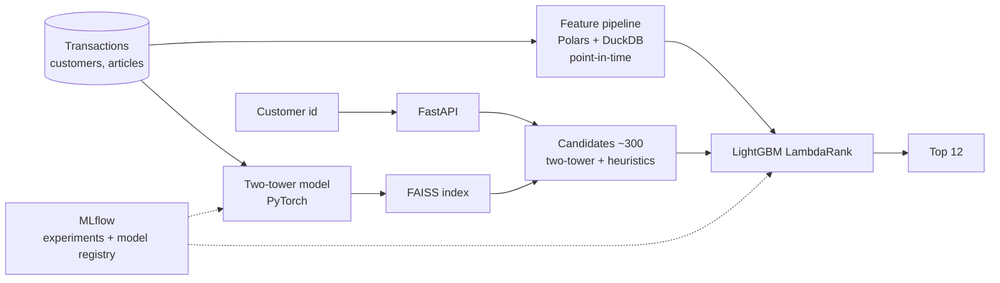

# Two-Stage Recommender

**Fashion recommendations the way large e-commerce companies build them: a two-tower retrieval
model, a learning-to-rank model on top, served under a latency budget.**

> 🚧 **Status: in development.** This README is the design document. Nothing below is a measured
> result yet; numbers in the evaluation section are targets.

## Why this project

Recommendation systems drive revenue at most product companies, and the standard production
design (retrieve a few hundred candidates cheaply, then rank them carefully) is different from
anything a single notebook model teaches. This project builds that design end to end on the
public **H&M Personalized Fashion Recommendations** dataset (31M transactions, 1.4M customers,
105k articles), including the parts that are usually skipped: time-based validation, a candidate
recall budget, and serving latency.

## What it will do

- **Candidate generation:** a two-tower model (PyTorch) trained on purchase sequences, indexed
  with FAISS, plus cheap heuristic candidates (repurchase, trending, co-purchase).
- **Ranking:** a LightGBM LambdaRank model on user, item and user-item features (recency,
  price affinity, colour/category preferences, embedding similarity).
- **Feature pipeline:** Polars/DuckDB jobs that build point-in-time-correct features, with no
  leakage from the validation week.
- **Serving:** a FastAPI endpoint returning 12 recommendations per customer within a latency
  budget, with cold-start fallbacks.
- **Analysis:** a simulated A/B test write-up (power, guardrail metrics) comparing the ranker
  with a popularity baseline.

## Architecture

## Tech stack

| Layer | Choice |
| --- | --- |
| Data | Polars, DuckDB, Parquet |
| Retrieval | PyTorch two-tower model, FAISS |
| Ranking | LightGBM (LambdaRank) |
| Tracking | MLflow (experiments and model registry) |
| Serving | FastAPI, Docker |
| Analysis | statsmodels / SciPy for the A/B simulation |

## Evaluation plan

Time-based split: train on all weeks before the last, validate on the final week.

| Metric | Stage | Target |
| --- | --- | --- |
| Candidate recall@300 | Retrieval | ≥ 0.40 of next-week purchases covered |
| MAP@12 | End to end | Beat popularity baseline by ≥ 2× |
| NDCG@12 | Ranking | Reported per ablation |
| Coverage / novelty | Catalogue share recommended | Reported |
| p95 latency | Serving | < 100 ms per request |

Ablations: heuristics only vs + two-tower candidates, ranker feature groups, embedding size.

## Milestones

- [ ] Data loading, time-based split, popularity and repurchase baselines
- [ ] Feature pipeline with point-in-time correctness tests
- [ ] Two-tower model + FAISS, candidate recall curve
- [ ] LightGBM ranker, MAP@12 vs baselines
- [ ] Ablation table tracked in MLflow
- [ ] FastAPI serving with latency benchmark
- [ ] A/B test simulation write-up

## Getting started

Setup instructions will land with the first working milestone.

## Author

Chirag Batra · [GitHub](https://github.com/thechiragbatra) · [LinkedIn](https://www.linkedin.com/in/chirag-batra-ds)
